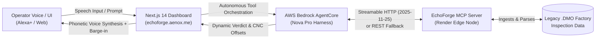

# EchoForge 🛠️
> **Autonomous Hands-Free Edge Metrology AI Assistant for Aerospace Manufacturing**  
> *Submission for the Amazon Developer Hackathon: Build, Ship, Shape (2026)*

[](https://opensource.org/licenses/MIT)
[](https://developer.amazon.com)
[-orange)](https://aws.amazon.com/bedrock/)
[](https://modelcontextprotocol.io)
[](https://echoforge.aenox.me)

---

## 🚀 Live Deployments & Verification
- **Web App / Simulated Alexa+ Console**: [https://echoforge.aenox.me](https://echoforge.aenox.me)
- **Live Edge MCP Server (Render)**: [https://echoforge-mcp.onrender.com](https://echoforge-mcp.onrender.com)
  - Health check: `GET https://echoforge-mcp.onrender.com/health`
  - Streamable HTTP MCP Endpoint: `POST https://echoforge-mcp.onrender.com/mcp`
- **Primary Hackathon Track**: **Alexa+** (Self-Hosted Streamable HTTP MCP Server & Simulated Alexa+ Interface)
- **Mini-Challenges Entered**:
  1. **AWS Builder**: AWS Bedrock AgentCore (Amazon Nova Pro), AWS Amplify SSR, IAM Security Policies.
  2. **Open Source**: MIT Licensed repository with open-source MCP metrology bridge.

---

## 🎯 The Problem & Our Solution
In high-precision aerospace manufacturing (turbine blades, engine flanges, casing bosses), coordinate-measuring machines (CMM) output complex legacy inspection files (e.g. `.DMO` / DMIS files) measured in fractions of a micron ($0.0001\text{ mm}$).

Cleanroom CNC machinists wearing protective gloves and face shields cannot operate keyboards or touchscreens while handling delicate components. 

**EchoForge** bridges this gap:
1. **Hands-Free Ambient Alexa+ Voice UX**: High-res speech recognition with hands-free loop and real-time **barge-in wake word detection** ("Echo", "Alexa", "Stop", "Cancel").
2. **Bedrock AgentCore Intelligence**: Powered by Amazon Nova Pro to interpret tolerance zones, calculate micron deviations, and autonomously invoke engineering repair workflows.
3. **Spec-Compliant MCP Metrology Bridge**: Implements the official **MCP 2025-11-25 Streamable HTTP specification** (`/mcp`) to ingest `.DMO` inspection files and output exact CNC offsets and tooling programs.
4. **Dynamic Speech Synthesis**: Fluid browser voice synthesis speaking physical engineering directives and micron tolerances with phonetic accuracy without hardcoded scripts.

---

## 🏗️ Architecture



---

## ⚙️ Supported Aerospace Metrology Features

| Inspection Feature | Nominal Dimension | Tolerance Zone | Engineering CNC Procedure |
| :--- | :--- | :--- | :--- |
| `UPPER_FLANGE` | $50.000\text{ mm}$ | $\pm 2.0\text{ µm}$ | CNC Re-Milling (Program 4A) with 1mm carbide end mill |
| `MAIN_BORE_HOLE` | $15.000\text{ mm}$ | $\pm 0.1\text{ µm}$ | Precision Diamond Honing with Titanium boring bar at 3200 RPM |
| `TURBINE_BLADE_ROOT` | $32.500\text{ mm}$ | $\pm 1.5\text{ µm}$ | EDM Spark Erosion (Cycle E-9) in dielectric fluid at 45A |
| `INLET_NOZZLE_RING` | $78.200\text{ mm}$ | $\pm 2.5\text{ µm}$ | Micro-Abrasive CNC Blending & ceramic passivation coat |
| `EXHAUST_STATOR_BOSS` | $24.000\text{ mm}$ | $\pm 1.8\text{ µm}$ | Facing Skim Cut & M24 Thread Re-Chasing |

---

## 📂 Repository Structure

```
.
├── frontend-dashboard/       # Next.js 14 App Router UI & AWS Bedrock AgentCore API
│   ├── src/app/
│   │   ├── api/agent/        # AgentCore InvokeHarnessCommand & MCP tool interceptor
│   │   ├── page.tsx          # Hands-free voice interface, barge-in wake word & dynamic TTS
│   │   └── globals.css       # TailwindCSS styling & responsive layout
│   └── package.json
├── mcp-server/               # Self-hosted MCP Server (MCP Spec 2025-11-25)
│   ├── server.py             # Streamable HTTP (/mcp), SSE (/sse), and REST endpoints
│   ├── factory_data/         # Live CMM .DMO simulated telemetry
│   ├── test_streamable_http.py # Automated test suite for MCP Spec 2025-11-25
│   └── requirements.txt      # Python dependencies (mcp, starlette, uvicorn)
├── planning/                 # Architecture, submission checklists, & friction logs
│   ├── HACKATHON_REQUIREMENTS.md
│   └── hackathon_overview.md
├── LICENSE                   # Open-source MIT License
└── README.md                 # Project documentation
```

---

## 🧪 Local Quickstart & Testing

### 1. Edge MCP Server (Python 3.12+)
```bash
cd mcp-server
python -m venv .venv
source .venv/bin/activate
pip install -r requirements.txt

# Run the test suite proving Streamable HTTP 2025-11-25 compliance
python test_streamable_http.py

# Launch local server (default: port 8000)
python server.py
```

### 2. Frontend Dashboard (Next.js 14)
```bash
cd frontend-dashboard
npm install

# Configure environment variables (.env.local)
# APP_AWS_REGION=us-east-1
# APP_AWS_ACCESS_KEY_ID=your_access_key
# APP_AWS_SECRET_ACCESS_KEY=your_secret_key

npm run dev
# Open http://localhost:3000 in your browser
```

---

## ⚡ Live API Verification

You can query the live production deployment directly via curl:

```bash
curl -s -X POST https://echoforge.aenox.me/api/agent \
     -H "Content-Type: application/json" \
     -d '{"prompt":"Query the live sensor deviation for UPPER_FLANGE and evaluate if it is within or out of tolerance."}'
```

And test the MCP Server Health:
```bash
curl -s https://echoforge-mcp.onrender.com/health
```
**Expected Response:**
```json
{
  "status": "healthy",
  "service": "EchoForge Metrology Bridge",
  "mcp_protocol_version": "2025-11-25",
  "transports": ["streamable-http (/mcp)", "sse (/sse)"]
}
```

---

## 📄 License
This project is open-source and released under the terms of the [MIT License](LICENSE).
