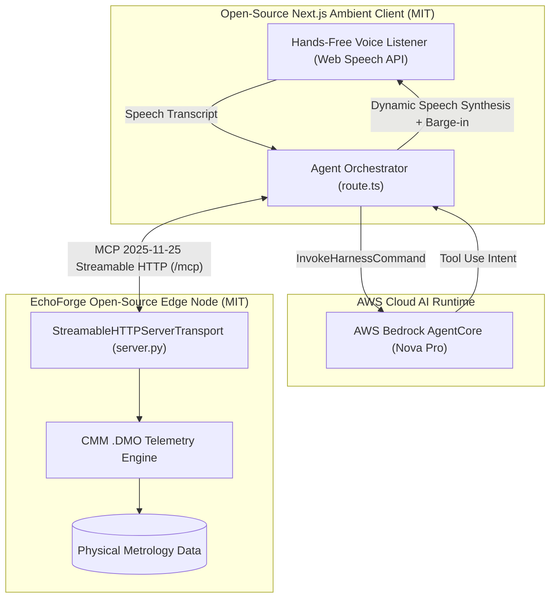

# Open Source Mini Challenge — Submission Documentation 🌐
> **Amazon Developer Hackathon: Build, Ship, Shape (2026)**  
> **Track:** Open Source Mini Challenge (alongside Primary Track: Alexa+)  

---

## 👤 Contributor & Repository Information
- **GitHub Username**: [`Ilyan321`](https://github.com/Ilyan321)
- **Project Repository URL**: [https://github.com/Ilyan321/alexa-plus-hackathon](https://github.com/Ilyan321/alexa-plus-hackathon)
- **Contribution URL (Commit History)**: [https://github.com/Ilyan321/alexa-plus-hackathon/commits/main](https://github.com/Ilyan321/alexa-plus-hackathon/commits/main)
- **License**: [MIT License](https://github.com/Ilyan321/alexa-plus-hackathon/blob/main/LICENSE) (Open Source, OSI-approved)
- **Live Deployed Demonstration**: [https://echoforge.aenox.me](https://echoforge.aenox.me)
- **Live Edge MCP Server**: [https://echoforge-mcp-fresh.onrender.com](https://echoforge-mcp-fresh.onrender.com)

---

## 🛠️ What We Did (Technical Scope)
During the hackathon window, we created **EchoForge** as a fully open-source, vendor-neutral industrial AI integration suite:

1. **EchoForge Metrology Bridge (`mcp-server/`)**:
   - Developed an open-source Python server implementing the official **Model Context Protocol (MCP) Spec 2025-11-25 over Streamable HTTP** at `/mcp`.
   - Built a parser for legacy aerospace Coordinate Measuring Machine (CMM) inspection data (`.DMO` / DMIS specification) capable of sub-micron tolerance evaluations.
   - Designed tools `query_dmo_deviation` and `get_repair_procedure` that calculate physical CNC machine tool offsets and remediation cycles (diamond honing, EDM spark erosion, orbital abrasive lapping, carbide re-milling).
   - Created an automated regression and compliance test suite (`test_streamable_http.py`) verifying RFC-compliant Streamable HTTP JSON-RPC 2.0 handshakes, tool discovery, and tool calling.

2. **Simulated Ambient Alexa+ Interface (`frontend-dashboard/`)**:
   - Built a full hands-free ambient voice interface using Next.js 14 App Router, TailwindCSS, and the Web Speech API.
   - Open-sourced a robust **Wake Word Barge-in Interruption** engine ("Echo", "Alexa", "Stop", "Cancel") that cleanly halts active text-to-speech playback without audio race conditions.
   - Built a **Dynamic Speech Formatter** (`formatAgentCoreSpokenText`) converting screaming-snake-case manufacturing acronyms and metric units (`µm` $\rightarrow$ "microns", `mm` $\rightarrow$ "millimeters", `M24` $\rightarrow$ "M 24") into natural phonetic speech.
   - Open-sourced the **AWS Bedrock AgentCore autonomous tool calling orchestration harness** with multi-turn prompt recency weighting.

---

## ⚙️ How It Works (Architecture & Protocols)

1. **Protocol Handshake**: Modern AI agents connect to the edge node via `POST /mcp` using header `mcp-protocol-version: 2025-11-25`. The server provisions an active session ID and streams JSON-RPC 2.0 events.
2. **Tool Invocation**: AgentCore calls `query_dmo_deviation` or `get_repair_procedure`. The server inspects physical nominal measurements vs. measured values and responds with exact tolerance zone deltas.
3. **Ambient Audio Loop**: The client receives Nova Pro's dynamic engineering verdict, sanitizes raw code/G-code, and synthesizes fluid conversational speech while maintaining an active background listener for barge-in wake words.

---

## 🌍 Why It Matters (Open-Source Impact)

### 1. Breaking Vendor Lock-In in High-Precision Manufacturing
In aerospace and defense manufacturing, metrology coordinate measurement machines (Hexagon, Zeiss, Mitutoyo) use proprietary, air-gapped software stacks. Data silos make it extraordinarily difficult for operators on cleanroom factory floors to query live quality control data hands-free.

EchoForge provides the **first open-source, vendor-neutral MCP bridge** for manufacturing metrology. It proves that legacy industrial file formats can be connected directly to next-generation ambient AI agents without purchasing million-dollar proprietary software licenses.

### 2. A Public Reference Implementation for MCP Streamable HTTP (2025-11-25)
The Model Context Protocol specification rapidly transitioned to **Streamable HTTP** as of late 2025. However, the wider developer ecosystem currently suffers from a lack of production-ready, open-source Python implementations running Streamable HTTP behind modern cloud proxies.

By releasing `mcp-server/server.py` and `test_streamable_http.py` under the **MIT License**, EchoForge offers the developer community a working, tested blueprint for:
- Implementing `mcp.streamable_http_app` alongside Starlette routes.
- Handling session lifecycles and DNS rebinding protections.
- Maintaining dual compatibility with legacy Server-Sent Events (`/sse`) and HTTP REST APIs.

